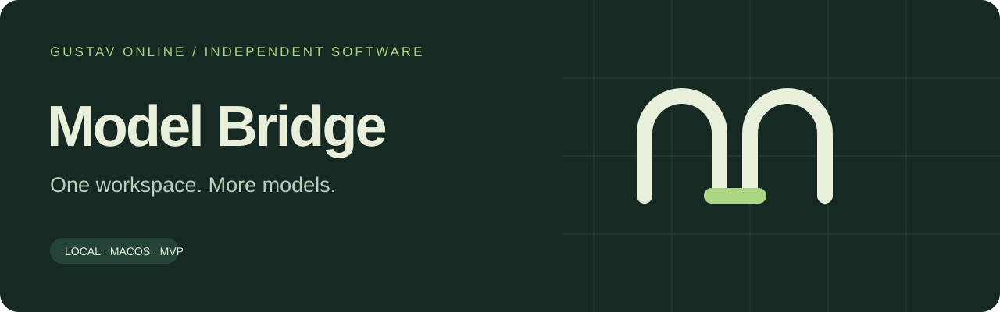

<p align="center"></p>

# Model Bridge

**Claude models in the Codex desktop app. By [Gustav Online](https://github.com/gustavonline).**

Keep the interface you use: model picker, conversations, browser and file panels. Model Bridge adds a small local adapter beneath Codex. Native models stay on Codex; Claude runs through your installed, unmodified Claude Code binary and the official Agent SDK.

> [!IMPORTANT]
> **macOS preview.** Core conversations and session coordination have automated and real-runtime tests. This is an independent integration, not an OpenAI or Anthropic product, approval, or guarantee of full feature parity. See the [support matrix](docs/support.md).

- Select GPT or Claude and keep the same visible conversation when switching.
- Edit and resend, queue messages, fork a conversation, and resume after restarting.
- Inherit Codex instructions, enabled skills and MCP tools, loaded on demand.
- Read and coordinate bridge chats through one small session adapter.
- Diagnose failures with correlated, rotating logs that omit message and credential content.

No replacement UI, model API proxy, extra service or permanent daemon. The adapter lives and exits with the isolated app. AIOS is an optional inherited plugin, not a dependency.

## Install

Requires macOS, Node.js 22 or newer, Python 3.11 or newer, and a compatible Codex desktop app. Use your own Claude Code installation and login; the installer can install the official CLI when absent. Sign-in happens through Anthropic's own flow. Subscription access and remaining quota are separate checks.

Download the installer ZIP from [Releases](https://github.com/gustavonline/codex-claude-bridge/releases), extract it, and run `Install Model Bridge.command`. Preview releases may be marked prerelease. A source checkout can produce the same package with `npm run bundle -- --pin`.

Alternatively, install the **Model Bridge** plugin ZIP, then ask its `setup` skill to start setup. The plugin has two skills: setup and diagnose. Installing the skills alone does not execute scripts or start a daemon.

The existing launcher is `~/Applications/Codex + Claude.command`; the stable CLI name is `codex-claude`:

```sh
codex-claude
codex-claude status
codex-claude doctor
codex-claude check
codex-claude stop
```

If the command is not on PATH, use `~/.local/share/codex-claude-bridge/node_modules/.bin/codex-claude`. Select a different app or existing isolated profile with `setup --app /path/to/Codex.app --state /path/to/profile`.

## One configuration

Your normal Codex profile is the source for instructions, skills, plugins and settings. Changes mirror one way into the separate profile before turns and approximately every ten seconds. Change global configuration in normal Codex; changes made only in the isolated copy may be replaced.

Claude initially receives five small tools for finding tools, calling a selected tool, finding skills, reading a selected skill, and shell execution. It does not receive every installed skill or tool schema. Current enablement and permissions are checked again at execution.

GPT follows the native provider selected in Codex, including ordinary OpenAI login or a configured gateway. The bridge adds Claude alongside that provider; it does not choose between several gateways serving identical GPT model names. Required provider environment variables must be present in the launch environment; their values are not stored by the bridge.

## Develop and verify

```sh
npm ci --ignore-scripts --omit=optional
npm run check
npm run bundle -- --pin
```

Tests and packaging run on Linux and macOS with Node 22/24. Actual desktop operation is macOS-only. Live tests consume quota and require explicit opt-in:

```sh
node scripts/live-test.mjs --run --app /Applications/Codex.app
```

Live tests use disposable local profiles, invented messages, official logins and public app-server calls. They never write to an existing user chat. A backend test does not prove that a desktop panel is visible.

Read [architecture](docs/architecture.md), [support and acceptance](docs/support.md), and [operations and releases](docs/operations.md). Contributors use short branches and PRs; run the checks on the exact revision sent for independent review. See [AGENTS.md](AGENTS.md) for the execution contract.

## Authentication and ownership

The bridge runs the unchanged Claude Code binary through the SDK. It does not read Claude credentials, imitate its HTTP client, distribute shared accounts or proxy usage. This preview selects the existing subscription login and filters inherited API/provider overrides to avoid accidentally switching billing. It does not implement an API-key product mode.

Anthropic distinguishes individual use of unmodified Claude Code from third-party products offering their own subscription login or routing credentials. Running the official binary is not an approval of this particular integration. Follow the current [Claude Code terms and authentication guidance](https://code.claude.com/docs/en/legal-and-compliance) and [Agent SDK guidance](https://code.claude.com/docs/en/agent-sdk/overview); a public subscription product needs its authentication approach qualified separately. This repository makes no account-enforcement guarantee.

MIT for this adapter. Codex, Claude Code and the SDK remain under their own licenses and terms. No vendor logos are used.
