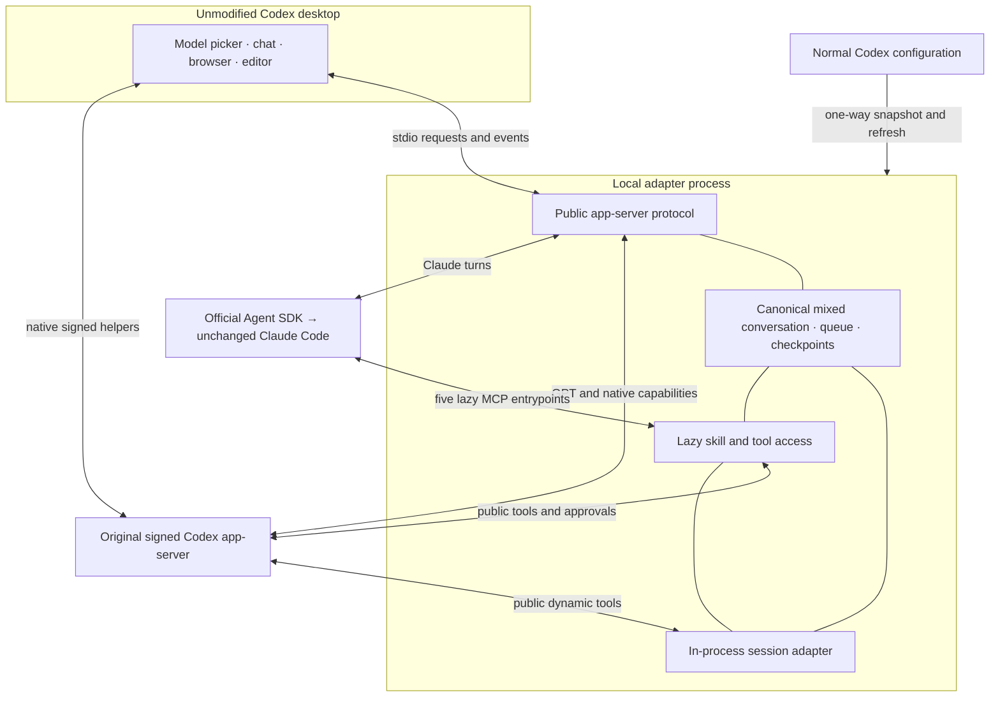

# Architecture

The boundary is a local stdio adapter under an unmodified Codex desktop process. The normal Codex profile remains the configuration source. Each isolated profile has its own desktop state, native threads, bridge history and logs.

This is a component/deployment boundary view, not a proposed replacement GUI. The diagram does not imply that every Codex feature is mapped.

## Ownership

- `bridge.mjs` maps the public protocol and streams, persists the visible mixed transcript and coordinates lifecycle locks.
- `claude.mjs` owns the official SDK boundary. Continuous persistent Claude turns resume its session; ephemeral turns reconstruct visible context in memory without session persistence.
- `providers.mjs`, `native-turns.mjs`, `history.mjs` and `fork.mjs` preserve native identities and exact retained prefixes across model changes and edits. Hidden reasoning is excluded from model handoffs.
- `capabilities.mjs` exposes five initial MCP entrypoints. Tool schemas and skills are selected lazily and configuration is rechecked before use.
- `sessions.mjs` adds two deferred dynamic tools over the existing lifecycle. It has no socket, database or service of its own.
- `launch.py` preserves the signed helper chain. Only a serving `app-server` passes through the adapter; other helper commands, and the desktop's one-shot `app-server --print-startup-config` policy query (wrapper and `bridge.mjs` both recognise it), exec the original signed CLI directly with its arguments, environment, stdin and exit status. Initial desktop preparation of the separate window makes a private one-time Codex/OpenAI `auth.json` snapshot when present. Compatibility checks (`smoke.mjs`) copy nothing from the source profile: they prepare a fresh synthetic source and profile in their own temporary directory and remove it afterwards. `mirror.py` and `mirror.mjs` subsequently synchronize selected configuration, not conversation or auth data; login refreshes are never copied back to normal Codex. Claude credentials are handled by the unchanged official Claude runtime.
- `logging.mjs`, `diagnose.mjs` and `cli.mjs` provide private diagnostics and operation.

## Session coordination

A caller can list/read/wait for bridge-managed chats in the same workspace and isolated profile, then send, queue, start a paused queue, interrupt an observed turn, or fork a finished prefix while the original turn continues. Read results are bounded and omit tool outputs unless requested; hidden reasoning is never returned. Ephemeral chats are visible only to themselves.

Mutations require the same resolved sandbox, approval policy, permission profile, configuration overrides and disabled-plugin set. Interactive policies require an explicit desktop approval for each new management action; declined, cancelled or outdated approvals do not dispatch. An explicitly selected `never` policy delegates these actions noninteractively within that matching boundary. Accepted retries return their existing receipt without another prompt. Models are still instructed to require human intent for sending/forking; the runtime enforces the selected policy, not a semantic interpretation of natural-language authorization. Workspace separation is a scope boundary, not an OS sandbox. Model-supplied flags cannot approve an operation.

Shell execution always requires a resolved sandbox. `never` and `on-request` allow execution inside it without escalation. The bridge conservatively asks before `untrusted` and `on-failure` commands because direct native `command/exec` has no agent approval handler. Unknown/granular prompt policies fail explicitly. Permission changes during approval invalidate the pending action. Native MCP-tool approval modes retain their separate configuration.

Stable message IDs deduplicate sends across concurrency and restart. Fork receipts prevent a retry from duplicating a possibly completed fork after an uncertain response. A successful request acknowledges acceptance, not completion; wait/read provides the actual outcome. Cancellation releases local waits; external side effects may already have happened.

Claude discovers these tools through its existing lazy interface. New managed chats also register them as public native dynamic tools, so GPT can use the same adapter after a model switch. Older chats and GPT-first chats adopted later may lack the native registration; use a new managed chat for GPT-side coordination. The adapter does not rewrite native rollout files to retrofit tools.

Native app tools still own navigation, panels and host/project behavior. Native search/share/export and native transcript readers may omit Claude history; the session adapter is the supported read path. Other profiles, remote/cloud tasks, worktree orchestration, goals and automations are outside this facade.

## State and failures

Fork selects a finished prefix before awaiting the SDK or native host. An active turn is excluded by default and cannot be explicitly included. The source keeps running; only concurrent history/settings changes remain exclusive. Archive/unarchive uses the native operation and notifications while retaining bridge history. Identical concurrent resumes of one chat share a single native resume; any other change during it is still rejected as busy. A Claude tool can archive its own chat and finish its answer; native GPT archive may interrupt its turn. Queued work stays paused after archive or Stop. When a running turn finishes during a fork or metadata operation, queue progress resumes after the lock is released only if that turn succeeded and the chat is not archived.

Live steering uses the public `turn/steer` contract and its required `expectedTurnId`. Each Claude turn keeps one official SDK query with a streaming input channel; `priority: next` delivers a correction at the next agent-loop boundary, including after an in-flight tool. It does not start another bridge turn or change the active model. Starting a queued message while a turn runs uses that same path. Native managed turns forward the public request to Codex.

Acceptance persists a user item and private retry receipt together with queue removal. SDK result/replay metadata confirms delivery; an earlier result cannot close a query with another accepted input pending. Explicit native rejection restores the queue. Transport uncertainty, cancellation and crash never automatically replay input: canonical history retains it, diagnosis counts unconfirmed receipts, and a deliberate follow-up can rebuild context. Editing/forking uses whole-turn boundaries, including every steering message in that turn. Reusing a client ID with different input is rejected.

A managed chat has a real native ID plus bridge-owned history. State is written by temporary file and rename, with private permissions. On restart, unfinished turns become interrupted and unfinished tool results become uncertain; they are not replayed automatically. A corrupt state file fails visibly rather than silently dropping a conversation.

Mixed-model handoff includes retained user messages, assistant replies and tool results as reference data. A long handoff can exceed a model's context limit; no automatic lossy summarizer is inserted. Very long context, compaction and historical image reconstruction remain explicit acceptance gaps.

SDK/runtime dependencies are pinned. Public protocol compatibility is checked after version changes. This catches interface drift; it cannot promise future app compatibility or prove visual desktop behavior.

## Connection manager (target; NOT implemented)

**Historical 4 November design status (superseded by the bound custom-provider implementation below).** Home then was a read-only diagnostic phase: it shows its own plugin connection and what it cannot confirm (see Support). It is not a connection manager and has no control. The Bridge side of a first Claude Code connection now exists in source (next section) but has no writer, so nothing in production changes behaviour yet. Everything else below, including address and authentication, other providers and a model picker the Bridge controls, is not a feature of this revision.

**Owner requirements (recorded 2026-11-04; the repository has no separate backlog, so they are kept here and in the unqualified list in Support).**
1. Use the unchanged official Codex desktop with the existing normal profile and history.
2. The plugin is available from a marketplace or GitHub. A simple activation after restarting the ordinary app is wanted and is **not** implemented (see Activation).
3. Home grows into a connection manager, not only a diagnostic panel. Target flow: provider or server address, authentication if needed, discover the model catalog, choose which models are visible in the picker, enable or disable the provider.
4. Keep the native GPT connections, login, projects, history and settings. Disabling or hiding a provider or a model never deletes chats.
5. Claude Code is the primary focus: the official SDK/CLI, with the native Codex tool bridge.
6. Local inference (the Z13) and OpenRouter target the Codex harness through a compatible inference transport. Discovering a server or its model catalog does not show that a harness works with it. A harness that is not supported needs an adapter and proof of its capabilities, and no feature is promised for all models.
7. The person does not hand-edit Codex configuration or a base URL. Plugin-owned connection state and runtime overrides are the target.
8. T3's provider adapters and capability descriptions, and Midium's connection experience, are design references only. They are neither a replacement UI nor a platform to copy. Midium’s Codex support is MCP sub-agents, not a replacement for the main model.

**Original design direction.** A small registry of connections kept by the plugin, each with an address, a credential reference that never reaches logs or the page, discovered models, a visibility flag per model and an enabled flag. Each provider would be a separate adapter declaring explicit capability flags (what it can do and what it cannot), so a provider that lacks a capability is shown as lacking it, not as a degraded Claude. Claude Code is the first adapter. Hiding or disabling only changes what the picker offers. It does not touch chats, which stay in the normal history.

**Observed, and what it does and does not show.** On 2026-11-04 (20:37 UTC) a synthetic probe in a fresh `CODEX_HOME` started a thread whose provider, `bridge_probe`, existed only in that thread's runtime configuration; it was accepted and ephemeral. The same request without the override failed with `-32600` “Model provider `bridge_probe` not found”, and the configuration file's hash did not change. No model call and no network model call was made, no owner profile was selected or copied, and no filesystem audit was performed. This supports a registry plus runtime-override design only. It does not show inference, the model picker, a provider that works in a chat, or what happens to history when a provider is disabled or the plugin removed.

**Not yet qualified:** real local inference; OpenRouter in the Bridge's own UI; a multi-provider model picker; automatic activation on an ordinary launch; a trial on the normal profile; chat history after a provider is disabled or the plugin is uninstalled.

**Activation (UNMET).** The wanted flow is: ordinary Codex, plugin installed, restart, and Claude is available. Today the Bridge is attached per launch, by `open -a … --env CODEX_CLI_PATH=<wrapper>` from the helper (the separate test window or `codex-claude primary`), so a Dock, Spotlight or login launch stays GPT-only. No supported plugin-only hook that registers a model provider has been verified. Options are being looked at only in public documentation and source, read-only. These are excluded unless the owner separately authorizes them: modifying the app, a login item or LaunchAgent, a persistent system environment variable, private IPC, or a silent implementation. The normal-profile trial in Operations uses an explicit, reviewed runtime and helper. It is a trial route, not the final activation experience.

**Not in scope now:** an arbitrary-URL, shell or token API; downloading models or runtimes; running local inference; new adapters; any key or paid call.

**References (read by the lead, not by this author):** OpenAI's plugin extensions and the `mcp-extensions` spec; the Codex advanced configuration page on custom model providers; T3 Code's “adding a provider” note; Midium's Codex sub-agent page; OpenRouter's Codex CLI tutorial. Their statements are inputs to review, not verified behaviour of this Bridge.

## Claude Code connection decision (source; NOT run on a Mac)

This is the Bridge side of the first connection-manager slice. It is separate from Home and from ordinary-launch activation. **Historical backend-only boundary:** the later explicitly bound Home sections below add writers and discovery; default portable Home remains unbound. The full normal-profile connection-manager/ordinary-launch outcome is still not delivered. The behaviour below applies only to a store that already exists.

**Store.** `connections.json` sits in the Bridge's own launch root (the parent of `BRIDGE_STATE`: `<state>/primary` for the main-app helper, `<state>` for the separate test window). No tool, argument or environment variable can choose it. The root must be a real directory owned by the user and not writable by others; the file must be a regular, private (0600) file, opened without following links, at most 256 KiB, with a strict version-1 schema. It holds one fixed `claude_code` connection: `enabled`, the explicit `visible` model ids (or all), the last observed official-SDK catalog (at most 64 models, bounded fields, with a revision, a fresh/stale label and an error code) and separate evidence states. It holds no token, address, command, profile or chat content. Updates take an exclusive lock file, compare an expected revision and replace the file atomically. A held lock is never taken over and a stale writer is refused.

**Disable generation.** The connection also holds `disableGeneration`, a counter, and `storeId`, a random 128-bit hex id fixed when the store is created. Every enabled-to-disabled transition increments the counter inside the same locked, atomic write that saves `enabled: false`; nothing else changes it: enabling, a catalog, visibility, offered evidence and a failed refresh leave it alone, and an update that tries to set it is refused. It is bounded (2^31 - 1): at the bound a further disable is refused with `generation_exhausted`, the file is left as it is, and the counter never wraps or saturates (enabling still works; replacing the store is an operator action that does not exist yet). A value beyond the bound, a negative or non-integer one, a malformed id, or only one of the two fields makes the store corrupt, so it is never repaired and Claude work is refused. The Bridge's *token* for a decision is `<storeId>:<disableGeneration>`; it is `none` when no store is configured (no file), and *unknown* when the store cannot be read or is in the earlier layout. Unknown never equals anything. A store of the earlier layout (version 1 without the two fields) is read and enforced as before (`enabled` and `visible` apply), but its generation is unknown, so it is never rewritten, never migrated and refuses every update with `legacy`; no data of an existing owner is touched by this source.

**Evidence kept apart.** `catalog` (observed from the SDK, no prompt), what the attached Bridge's `model/list` last offered, and the fixed values `authentication: unknown`, `inference: unverified` and `picker: unknown`. Nothing in this code can observe the last three. A catalog is not a login and a login is not inference.

**Defaults.** No file means the earlier behaviour: enabled, every model visible, whatever the launch root's permissions look like. Once a file exists it is inspected strictly. A file that is corrupt, oversized, linked, a FIFO or other non-regular file, group-readable, of another version or in an unsafe root is never repaired, and new Claude work is refused with a visible reason until it is fixed. Reading and reopening an existing chat start no Claude work and need no SDK, so they stay available; GPT is not affected.

**Enforcement in the Bridge** (read from the store at each decision, so a change applies without a restart). Two independent reviews (candidate `a5b29dd`, then `a94219c`) found gaps in this list; the entries below describe the repaired source. They are covered by `test/connection-regressions.test.mjs`, `test/connection-admission.test.mjs`, `test/connection-r2.test.mjs` (the round 2 review probes, ported), `test/connection-generation.test.mjs` (the store, dependency-free) and `test/connection-generation-bridge.test.mjs`. What was actually run, and what was not, is in [Support](support.md); `test/connections.test.mjs` includes a FIFO case that is refused for every actor in the task that produced this repair and was not run there.
- `model/list` returns the native catalog first and unchanged (all pages), then the Claude models that are enabled and visible. A hidden or disabled model appears only with `includeHidden`, marked hidden. A disabled or unreadable connection never starts the SDK for a listing; `includeHidden` then uses the last validated catalog (in memory, or from the store). While disabled and readable, the offered evidence records the empty offer, so it is what `model/list` last offered; it is written the same non-waiting way as before, and an unreadable store is not written to or repaired. A Claude id that a native model already uses is not overwritten.
- The SDK catalog is validated once when it is loaded. A catalog with more than 64 models, a repeated or malformed id, or oversized fields is an explicit failure: it is neither offered nor selectable, it is not cached, and the evidence records `failed`.
- New Claude work is refused when disabled: a new Claude chat, adopting a chat to Claude, a new turn (from the desktop or the session tools), a started queued message, a settings change to Claude, a fork and a session `create`. This includes starting a queued message into a turn that is already running (`queue/start`, the session `start_queue`, or `turn/steer` naming the queued message), checked again just before it is committed. Steering a new message into an admitted turn is not new work and stays allowed, as does anything on a GPT turn. A repeat of an already accepted request is answered, not refused.
- A hidden model is refused only as a new choice. Resuming a chat does not choose a model: only a true reopen (the chat's own Claude model, or none named) keeps the retained model and effort without asking the SDK. A resume that names any other Claude model is a new choice and takes the same admission, so it cannot change a chat's model around hide or disable. The last check before a turn is accepted names the model actually being admitted.
- A running turn, and steering already accepted for it, finish. Queued Claude messages stay queued, and the pause is durable. It is a marker saved with the chat (`queuePaused: provider_disabled`) and it does not depend on the Bridge having seen the disable: a Claude-owned queue is also bound to the disable generation token (`queueGeneration`, saved with the chat) when it becomes nonempty, when it becomes Claude's through a provider change, and when it is explicitly started. The marker is set the first time any of these finds a refused decision, a different token or an unknown one: when the restored chats are loaded, at an automatic continuation, immediately before an automatic start is committed (after its preparation, so a disable and re-enable in between is caught), and when a message is queued while disabled. So disabling and re-enabling before a turn completes, while the Bridge was stopped, from another instance or process sharing the store, or with the explicit start refused in between, all leave the queue waiting. An existing marker is honoured before the chat's current provider is considered, and the stamp stays with the chat across a move to GPT, so Claude-intended work does not run on a GPT turn, whether Claude stays disabled or is enabled again. A plain GPT queue has no marker and no stamp and keeps working. Nothing replays on re-enable, restart, a later ordinary message, a completion or resume race, or a provider switch; queued IDs, content and history are kept. Only an explicit queue start or an empty queue ends the pause; accepted batch behaviour is unchanged: an explicit start of one item resumes the batch (the rest are bound to the generation read when that start began, before any wait, so a disable that lands while the start is in flight, or any later one, pauses them again) and no per-item start is required, except on a store of the earlier layout (below). A queue bound while the generation is unknown (an unreadable or earlier-layout store) is stamped with the value `unknown`, which never equals a token, instead of losing its stamp: it keeps its Claude provenance on both providers, so it waits for an explicit start on GPT as well. A Claude-owned queue with no stamp at all (a chat saved before stamps existed) is not proof that nothing was disabled either, so it too waits for an explicit start; this is a one-time wait for such saved chats, and it applies equally when there is no `connections.json` at all or no connection root, because the saved queue carries no proof either way. A fork starts with an empty queue and neither the marker nor the stamp, and the source chat's queue is untouched; the fork's own first queued message gets its own binding. Enabling again does not itself start or replay anything.
- Limits of the generation, stated plainly. It records only transitions made through this module's store. A store that was unreadable and was repaired in place without the Bridge reading it in between cannot show an event, so an unobserved corrupt interval cannot manufacture one; the same class: an out-of-band edit, or restoring an older copy of the store file with the same `storeId`, can make an old stamp match again after a later disable (a store replaced by a new one has another `storeId` and counts as a change). An unreadable store is fail-closed whenever it is observed. A queue that was stamped `none` (no store) is held once a store exists, because the token then differs. On a store of the earlier layout (and while the store is unreadable) the generation is unknown, so an explicit start can only bind the rest of the queue to `unknown`: the batch semantics above do not hold there and each queued message needs its own explicit start, on Claude and on GPT (nothing in production creates such a store). On an earlier-layout store a disable is refused with `legacy` (the store is never rewritten), so the owner's disable intent fails with an error rather than taking effect, and every `model/list` that would record offered evidence, and every catalog refresh, logs `connections.record_failed` for it. The saved pause reason is the same `provider_disabled` for every cause (a disable, a changed generation, an unknown one, a saved queue without a stamp); only the log line `queue.pause_marked` carries the cause (`generation_changed` or `generation_unknown`), so a pause is not by itself proof that Claude was disabled. Starting a queue through the session tool's `start_queue` counts as an explicit start and ends the pause; that behaviour predates the generation and is not changed here. The counter is bounded at 2^31 - 1: a disable at the bound is refused with an error and Claude stays enabled (unreachable in practice; the file is not touched). Fixtures prove the logic with a fake native host; they are not native, Mac or GUI proof.
- A create request refused because the decision changed during approval is refused before a receipt is reserved, so retrying the same request after enabling works. A genuinely uncertain outcome still keeps its receipt.
- Reading, listing, reopening, archiving, reverting and moving a chat to GPT start no Claude work and stay available.
- The SDK catalog is asked for once per process (as before) and again only through `refreshCatalog`, which shares one in-flight request and keeps the last good catalog (labelled stale) when a refresh fails. Evidence writes from the Bridge take the lock once and never wait on the event loop; a held lock is logged and never taken over.
- The saved visible models are kept as the person chose them. A model missing from a partial catalog is unavailable for now, not forgotten, and returns when a catalog lists it again; a model that was never chosen is not shown unasked.

**Historical unbound-Home limitation (before the explicit task binding below).** Home would need to be provably bound to the running Bridge's launch root before it could write that file, and no verified public mechanism does that:
1. Codex's stdio MCP environment and configuration contract for plugin servers has **not been inspected** by this work, so the handoff is unverified, not shown impossible. What is known: the Bridge passes its environment, including `BRIDGE_STATE`, to the native app-server it starts; the portable `mcp.json` in this plugin sets no `env`; and a third-party description of the Agent Plugins `mcp.json` format documents expansion of `${PLUGIN_ROOT}` and `${PLUGIN_DATA}` only (not confirmed for Codex). Whether a plugin MCP process receives `BRIDGE_STATE`, or can be given it by a documented field, is unknown.
2. The Bridge does not know the plugin's data directory, so a shared location cannot be derived on the Bridge side either. A fixed global path is exactly the unscoped state the owner rejected.
3. Home is dependency-free and cannot run the pinned SDK; discovery has to run inside the Bridge or its runtime, which needs a control channel that does not exist (and none may be built as a socket, daemon or private IPC).
So Home stays read-only and unbound for now. Ways to supply the missing contract, none implemented: Mac-verify that Codex gives plugin MCP processes a stable `${PLUGIN_DATA}` and that the Bridge can learn the same directory through a public call; a deliberate terminal command that takes the explicit launch root; or a control server the Bridge itself offers through a verified app-server mechanism. Each needs its own authorization and proof.

**Local models.** Observations about local-model inference (#125) are input for a future adapter only. They are not proof of any Pi-to-Bridge integration, and no local model is used or required here.

**Upstream boundary (recorded from the lead's inspection of upstream sources on 2026-11-05; this author did not read them, and they are not the installed Mac binary).** Plugin extensions provide MCP Apps entrypoints, resource UIs and display modes, not a model transport. The hooks documentation describes model-request hooks as diagnostic only and session-start context as context only. Newer app-server sources expose `modelProvider/list` and `modelProvider/config/write`, which write custom-gateway settings into the active user configuration without selecting a default, authenticating or contacting the provider. That is a possible path for a compatible inference server, not a plugin-owned ephemeral registry and not a way to register the Claude Code SDK as the agent harness. No verified plugin-only route attaches the Claude adapter to an ordinary app launch and publishes its models beside GPT. The missing piece is a supported startup and agent-adapter registration plus a provider and model-catalog contribution, refresh and selection contract that a plugin can use, with defined lifecycle and history behaviour. Until then the helper-attached Bridge is a per-launch trial route, not install-and-restart activation. T3's provider adapters and capability flags and Midium's connection experience stay design references, not a platform to copy.

## Fixed-Claude Home controls (6 November source candidate)

The default portable `mcp.json` is unchanged: it starts `home/server.mjs` without a binding and exposes only the read-only Home. `home-v5.html` adds controls through public MCP Apps `tools/call`, not a shell, URL, arbitrary-file or private Codex API. The page requires both a valid synthetic binding result and `hostCapabilities.serverTools`; without either, it sends no control call and shows the limitation. Global/thread entrypoint declarations and inline fallback are retained. Actual native rendering/tool proxy support for this new candidate is UNRUN.

The explicit `home/test-server.mjs --test-binding /absolute/task/home-test-binding.json` entrypoint is only for a synthetic test. The operator first runs the create-only `scripts/prepare-home-test.mjs /new/absolute/task-root` from this frozen source. It creates fixed private children `profile`, `state`, `backend`, a declared synthetic profile/Bridge/binding ID triple, and a new connection store. It copies only the accepted connection module to `backend/connections.mjs`; no profile, auth, normal settings or history is copied. The controller verifies the accepted module SHA256 before importing those verified bytes; it loads no SDK/Claude executable. `profile/bridge-home-test.json` is a synthetic marker, not proof of the native host's CODEX_HOME or an authenticated Bridge process. The IDs bind requests to this declared scope; they are public context IDs, not authentication secrets or a multi-user security boundary.

The manifest has no selectable paths. The server derives the only store as `<task-root>/state/connections.json`, checks canonical nonlinked parent directories, private ownership/modes, directory identities, marker/manifest bytes, pinned backend and store ID before actions, and refuses drift. The page submits only the ID triple, expected revision, a boolean or bounded model selection. Wrong/unbound/profile-mismatching/stale/malformed requests fail before a write. Enable/disable and visibility use the accepted backend functions. Refresh validates the injected fixture catalog and commits through its existing expected-revision locked update; failure, timeout, invalid catalog or a concurrent revision change is not recorded as success. Successful writes stay in the store directory (including its transient lock/atomic-write file). Low-level I/O failure is not a guarantee of automatic rollback: preserve any partial test state and inspect it; never retry/clean silently. No other fixed child or unrelated file is writable through these tools.

The catalog in this entrypoint is explicitly **synthetic fixture data**, not actual SDK discovery, login, inference or a live native picker. The test seam can inject bounded catalog results/failure/timeout; the UI cannot choose a runtime, endpoint, command, token or discover function. The default has Fixture Haiku and Fixture Sonnet and performs no network/model/runtime call. A real catalog/backend transport and native-profile binding are later separately qualified work, not silently enabled here. All tools except the Home render tool use app-only visibility metadata; annotations distinguish read-only status from mutations. That metadata is not relied on as authorization: every call is checked server-side.

UI outcomes are correlated to their request IDs and scope/revision. Pending requests disable writes; failure, timeout or cancellation clears displayed facts while retaining only the last verified scope for an explicit status read. Late action replies and unsolicited results cannot clear uncertainty; only a successful correlated same-scope read restores controls, with no automatic write retry. Unsaved model selections survive unrelated host-context/theme renders and reset on a confirmed state response or a changed scope/revision. Teardown removes listeners/timers. Results and catalog labels use text nodes, not markup. Authentication, inference and native profile/activation remain unverified, even after a successful test-store write. Backend disable-generation, queue/history/GPT/fork semantics are unchanged.

The accepted `c4b962e` protocol export has Root's 28/28 synthetic consumption result (9 admission and 19 durable-queue checks). This candidate is a new Home source increment; it is not covered by the earlier acceptance and has not been installed. Full npm/package/distribution/native tests remain held/unrun. The original FIFO refusal, T3 bootstrap failures and host pipe failures remain retained; regular-file batch stdio plus a synthetic host/VM is not native Desktop or interactive-pipe proof.

## Custom Responses providers — isolated source increment, 6 November

The loopback/no-auth CLI intermediate is retained in Git; it is not the final product constraint. `home/providers.mjs` now shares a generic per-provider registry between the Bridge native router and the explicit `home/provider-server.mjs` controller. Each connection has a random ID, immutable canonical base URL/auth-reference/protocol, independent catalog observation, selected namespaced model and enabled flag. HTTPS supports custom DNS/API base paths with normal TLS verification; plaintext HTTP is limited to explicit literal loopback. No redirects, URL credentials, queries, insecure-TLS option, ambient proxy/header inheritance, model download or model API translator is added. Names and ports from operator examples are not registry assumptions. Changing an endpoint means creating a new connection; it cannot inherit another endpoint's credential reference.

Discovery is an explicit GET of the selected base URL plus `/models`, with a five-second total deadline and512KiB body limit. A generic OpenAI ID list is stored as exactly that, not a Codex ModelsResponse or evidence of effort/context/tool/image support. Native catalog rows and GPT defaults are unchanged. Failed credential resolution and failed HTTP discovery share the expected-revision stale transition, retaining prior models/selection without overwriting a newer revision. New local admission/selection requires a fresh catalog. Canonical URL length and the complete record are validated before publishing a provider directory, including IDNA expansion. Existing native-thread history is retained. Per-provider updates use bounded nonwaiting locks and expected revisions; creation is exclusive, capped at16 providers and256 models/provider. Unknown/unsafe files are not repaired. These are private same-user task directories, not an adversarial namespace boundary or atomic multi-file snapshot.

`provider-controls.mjs` takes one operator-selected `provider-home-binding.json` at startup. Its fixed profile/state children, marker IDs and metadata are checked before actions; tool requests carry those public context IDs and closed action arguments, never paths, commands, credentials or another profile. IDs establish declared context, not authentication or actual host profile identity. The Home public MCP Apps controls connect/discover/select/enable/disable; data/action recovery and unsaved inputs survive normal lifecycle updates. App-only tool metadata is not treated as a filesystem or user-authentication boundary. Default `mcp.json` remains unbound/read-only. Current dashboard payload URI is `home-v7.html` (v6 retained as the earlier isolated operator baseline).

An optional operator-provided protected reference file maps opaque auth IDs to exact canonical endpoints and private regular credential files. No credential value is stored in the registry, Home result, native thread options, logs or environment. Catalog authentication is consumed only in memory by the trusted catalog control plane. Native inference uses the official command-backed `auth` contract with the fixed shipped Node/helper and fixed arguments, never an arbitrary command API. It omits incompatible env-key/bearer/OpenAI-auth fields. The helper checks URL binding, ownership/private modes, regular one-link files and finite token size before emitting only the token to its native caller. Root must prove the actual native/model-tool filesystem boundary excludes both key/reference access and helpful invocation; same UID and0600 alone do not prove that. No owner key was read by the source author.

New explicitly namespaced thread/start requests get native `modelProvider` and a thread-scoped `config.model_providers` definition. Native app-server owns inference, streaming, tool execution/approval, permission enforcement and history. Version2 route sidecars retain provider/endpoint/model plus native thread ID, rollout-path metadata and fork parent, not chat contents or keys. Resume/fork reject alternate history or unknown path hints; a known matching hint is stripped so native uses only the saved thread ID. Resume identity/path/ancestry and fork new-ID/source ancestry are checked before accepting a route. Old v1 sidecars remain readable by exact ID without implicit migration, but accept no path hints. Saved-route settings/collaboration metadata maps endpoint model slugs back to the namespaced public ID; unconfirmed custom settings are not emitted as a different picker identity. Endpoint/auth edits fail the retained-route fingerprint. Existing GPT/Claude chats cannot silently switch to this adapter. New custom-provider queue add/start is explicitly unqualified/refused rather than risking automatic replay after disable; existing GPT/Claude queue semantics remain on their accepted paths. Enabling never starts a turn. This is not full cross-provider history portability.

Native catalog ownership is not inferred from the last UI list. Before an unclaimed namespaced new-thread/resume choice, the router reads native `model/list` with includeHidden and bounded paging (at most100pages, repeated/unverified cursors fail closed), without SDK inference. Observed native aliases in the Bridge namespace are retained in a fixed private `native-model-ownership.json`, under an exclusive nonwaiting lock and atomic replacement, capped at4096 aliases/512KiB. Restart, hidden/intervening lists, provider disable or catalog disappearance never silently reassign a retained native alias to custom. Ordinary native IDs need no claim file. Ownership errors refuse custom admission/offer; existing native catalog rows are retained. No automatic deletion or repair is performed.

Startup/hot refresh boundary: the operator must bind the same state directory to the helper-attached Bridge and the provider Home. Credential-reference path is a startup input (`BRIDGE_PROVIDER_CREDENTIAL_BINDINGS` for the Bridge; declared manifest field for Home), not a tool-selectable path. Catalogs, selected models and enabled decisions are read from the registry for the next explicit request. Each public `model/list` appends enabled/fresh, slot-selected discovered models as conservative Bridge presets before existing Bridge pagination, preserving all native GPT/Claude rows and defaults. Existing id/model collisions win; custom rows are omitted rather than replacing them. Disabled, unknown or stale providers are omitted even for includeHidden. Presets use the operator-supplied generated0.162.1 Model schema: text only, no advertised reasoning options, no service/context/tool limits, nondefault and multi-agent disabled. They do not certify endpoint inference capabilities. A returned namespaced model selects a new native-routed thread; it never silently retargets existing GPT/Claude chats. No undocumented refresh notification is sent: a later list sees current state, while actual desktop picker refresh/caching/visibility still needs Root's observation. Initial plugin registration/helper attachment and later ordinary-launch integration remain separate. Supported native provider configuration is documented at https://developers.openai.com/codex/config-reference ; thread/turn/stream ownership at https://developers.openai.com/codex/app-server . Host/version acceptance is still required.

## Curated custom model slots and Home v7

The existing global/thread entrypoints are retained, not duplicated. Home initializes through public MCP Apps and, if the host has not already supplied its result, makes one no-argument `bridge_home` read using advertised server tools. A bounded read failure offers explicit Reload, never a model prompt or write retry. The new dashboard groups connections, an explicit Add flow, a searchable model library and model slots; diagnostic/scope/protocol observations remain collapsed. It uses system fonts, theme tokens, responsive layouts with numbered near-square slot tiles above the library and bounded keyboard-scrollable lists, labeled controls and keyboard-operable Add/Remove/Save actions (optional native drag/drop adds only a discovered model to the local draft), without remote assets or new dependencies.

Slots are a separate optional `model-slots.json` in the same fixed Bridge state root: exact version1, positive revision and an ordered unique array of namespaced custom model IDs. Absence reads as revision0/models:null and preserves the legacy offer-all-enabled/fresh behavior **without writing or migrating provider records**. The first explicit Save creates a curated array; an empty array hides all custom presets. Subsequent discovery never adds new slots. The existing 16-provider/256-model catalog envelope gives a maximum4096 IDs, not a small fixed UI slot count. Private file read/write is bounded at4MiB; only this MCP save request gets the matching larger envelope, other requests retain65536B. Writes use a nonwaiting exclusive lock, expected slot revision and atomic file replacement; failed/partial evidence is not repaired or deleted automatically. The Home action also checks declared scope and aggregate provider+slot revision.

Only new slots must identify an enabled, fresh discovered model. Saved stale, disabled or removed models remain visible as unavailable until explicitly removed, and are omitted from picker offers. A corrupt/unreadable policy fails closed rather than restoring all models. Native GPT/Claude rows/defaults, collision ownership and pagination remain intact. Hiding is not a permission boundary: explicit IDs still use the normal provider admission policy, and existing thread/history/resume/fork routing is unchanged. Provider disable and custom queue/cross-provider restrictions remain separate.

Drafts survive theme/context renders, filtering, provider selection and uncertain-result recovery. A concurrent slot revision requires explicit Keep my draft (rebase) or Use saved slots; no automatic overwrite. Cancelled writes have unknown outcome, late replies are ignored and further writes wait for an explicit same-scope status read. A confirmed matching committed selection can then clear the draft, without replaying the write. Slots affect the next public list; no desktop cache/hot-refresh claim is made.

The tile refinement retains the v7 protocol/resource and backend schema. At least five display cells are shown when few models are selected, including empty Add targets; every selected model is rendered, with one further browse target when five or more are selected. Empty cells only focus the existing library/search and are never persisted positions, GPU allocation or a five-model cap. Number, model initial, full name/provider labels and Remove actions stay available to assistive technology; names use a bounded two-line tile area; full names and saved IDs are available through accessible Details below the grid, without expanding the tile. Known-ID drag/drop adds a draft, with a visible drop outline and native Add/Remove keyboard alternatives. The compact Connections panel stays left on desktop and stacks on small screens. Save remains outside the tile scroll region.

The display repair following `4392435` keeps fixed, non-overlapping name/provider/action rows inside the square tile. Details/Close are keyboard/touch controls with focus return; disclosure makes no MCP call or store change and closes on uncertain state/teardown. If a saved ID is absent from every catalog, Home decodes only its saved namespaced label for display (not a catalog/inference assertion), retains a visible ID fallback when decoding is unavailable, uses a short derived display code (with collision disambiguation, not a security identifier) to distinguish equal saved names, and includes the exact ID in tile/Details/Remove accessible labels. Two missing identities remain separately inspectable/removable.
