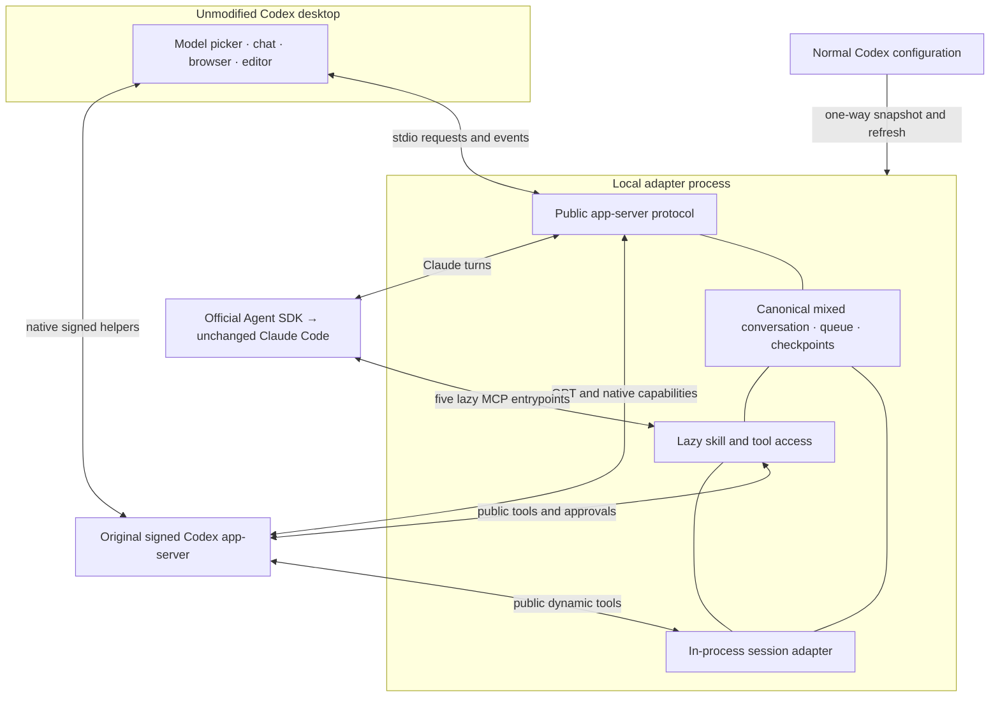

# Architecture

The boundary is a local stdio adapter under an unmodified Codex desktop process. The normal Codex profile remains the configuration source. Each isolated profile has its own desktop state, native threads, bridge history and logs.

This is a component/deployment boundary view, not a proposed replacement GUI. The diagram does not imply that every Codex feature is mapped.

## Ownership

- `bridge.mjs` maps the public protocol and streams, persists the visible mixed transcript and coordinates lifecycle locks.
- `claude.mjs` owns the official SDK boundary. Continuous persistent Claude turns resume its session; ephemeral turns reconstruct visible context in memory without session persistence.
- `providers.mjs`, `native-turns.mjs`, `history.mjs` and `fork.mjs` preserve native identities and exact retained prefixes across model changes and edits. Hidden reasoning is excluded from model handoffs.
- `capabilities.mjs` exposes five initial MCP entrypoints. Tool schemas and skills are selected lazily and configuration is rechecked before use.
- `sessions.mjs` adds two deferred dynamic tools over the existing lifecycle. It has no socket, database or service of its own.
- `launch.py` preserves the signed helper chain. Only `app-server` passes through the adapter; other helper commands exec the original signed CLI directly. Initial desktop preparation of the separate window makes a private one-time Codex/OpenAI `auth.json` snapshot when present. Compatibility checks (`smoke.mjs`) copy nothing from the source profile: they prepare a fresh synthetic source and profile in their own temporary directory and remove it afterwards. `mirror.py` and `mirror.mjs` subsequently synchronize selected configuration, not conversation or auth data; login refreshes are never copied back to normal Codex. Claude credentials are handled by the unchanged official Claude runtime.
- `logging.mjs`, `diagnose.mjs` and `cli.mjs` provide private diagnostics and operation.

## Session coordination

A caller can list/read/wait for bridge-managed chats in the same workspace and isolated profile, then send, queue, start a paused queue, interrupt an observed turn, or fork a finished prefix while the original turn continues. Read results are bounded and omit tool outputs unless requested; hidden reasoning is never returned. Ephemeral chats are visible only to themselves.

Mutations require the same resolved sandbox, approval policy, permission profile, configuration overrides and disabled-plugin set. Interactive policies require an explicit desktop approval for each new management action; declined, cancelled or outdated approvals do not dispatch. An explicitly selected `never` policy delegates these actions noninteractively within that matching boundary. Accepted retries return their existing receipt without another prompt. Models are still instructed to require human intent for sending/forking; the runtime enforces the selected policy, not a semantic interpretation of natural-language authorization. Workspace separation is a scope boundary, not an OS sandbox. Model-supplied flags cannot approve an operation.

Shell execution always requires a resolved sandbox. `never` and `on-request` allow execution inside it without escalation. The bridge conservatively asks before `untrusted` and `on-failure` commands because direct native `command/exec` has no agent approval handler. Unknown/granular prompt policies fail explicitly. Permission changes during approval invalidate the pending action. Native MCP-tool approval modes retain their separate configuration.

Stable message IDs deduplicate sends across concurrency and restart. Fork receipts prevent a retry from duplicating a possibly completed fork after an uncertain response. A successful request acknowledges acceptance, not completion; wait/read provides the actual outcome. Cancellation releases local waits; external side effects may already have happened.

Claude discovers these tools through its existing lazy interface. New managed chats also register them as public native dynamic tools, so GPT can use the same adapter after a model switch. Older chats and GPT-first chats adopted later may lack the native registration; use a new managed chat for GPT-side coordination. The adapter does not rewrite native rollout files to retrofit tools.

Native app tools still own navigation, panels and host/project behavior. Native search/share/export and native transcript readers may omit Claude history; the session adapter is the supported read path. Other profiles, remote/cloud tasks, worktree orchestration, goals and automations are outside this facade.

## State and failures

Fork selects a finished prefix before awaiting the SDK or native host. An active turn is excluded by default and cannot be explicitly included. The source keeps running; only concurrent history/settings changes remain exclusive. Archive/unarchive uses the native operation and notifications while retaining bridge history. Identical concurrent resumes of one chat share a single native resume; any other change during it is still rejected as busy. A Claude tool can archive its own chat and finish its answer; native GPT archive may interrupt its turn. Queued work stays paused after archive or Stop. When a running turn finishes during a fork or metadata operation, queue progress resumes after the lock is released only if that turn succeeded and the chat is not archived.

Live steering uses the public `turn/steer` contract and its required `expectedTurnId`. Each Claude turn keeps one official SDK query with a streaming input channel; `priority: next` delivers a correction at the next agent-loop boundary, including after an in-flight tool. It does not start another bridge turn or change the active model. Starting a queued message while a turn runs uses that same path. Native managed turns forward the public request to Codex.

Acceptance persists a user item and private retry receipt together with queue removal. SDK result/replay metadata confirms delivery; an earlier result cannot close a query with another accepted input pending. Explicit native rejection restores the queue. Transport uncertainty, cancellation and crash never automatically replay input: canonical history retains it, diagnosis counts unconfirmed receipts, and a deliberate follow-up can rebuild context. Editing/forking uses whole-turn boundaries, including every steering message in that turn. Reusing a client ID with different input is rejected.

A managed chat has a real native ID plus bridge-owned history. State is written by temporary file and rename, with private permissions. On restart, unfinished turns become interrupted and unfinished tool results become uncertain; they are not replayed automatically. A corrupt state file fails visibly rather than silently dropping a conversation.

Mixed-model handoff includes retained user messages, assistant replies and tool results as reference data. A long handoff can exceed a model's context limit; no automatic lossy summarizer is inserted. Very long context, compaction and historical image reconstruction remain explicit acceptance gaps.

SDK/runtime dependencies are pinned. Public protocol compatibility is checked after version changes. This catches interface drift; it cannot promise future app compatibility or prove visual desktop behavior.
